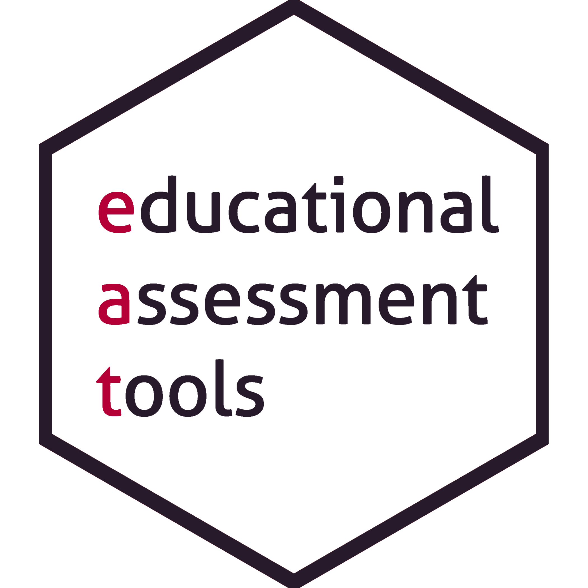
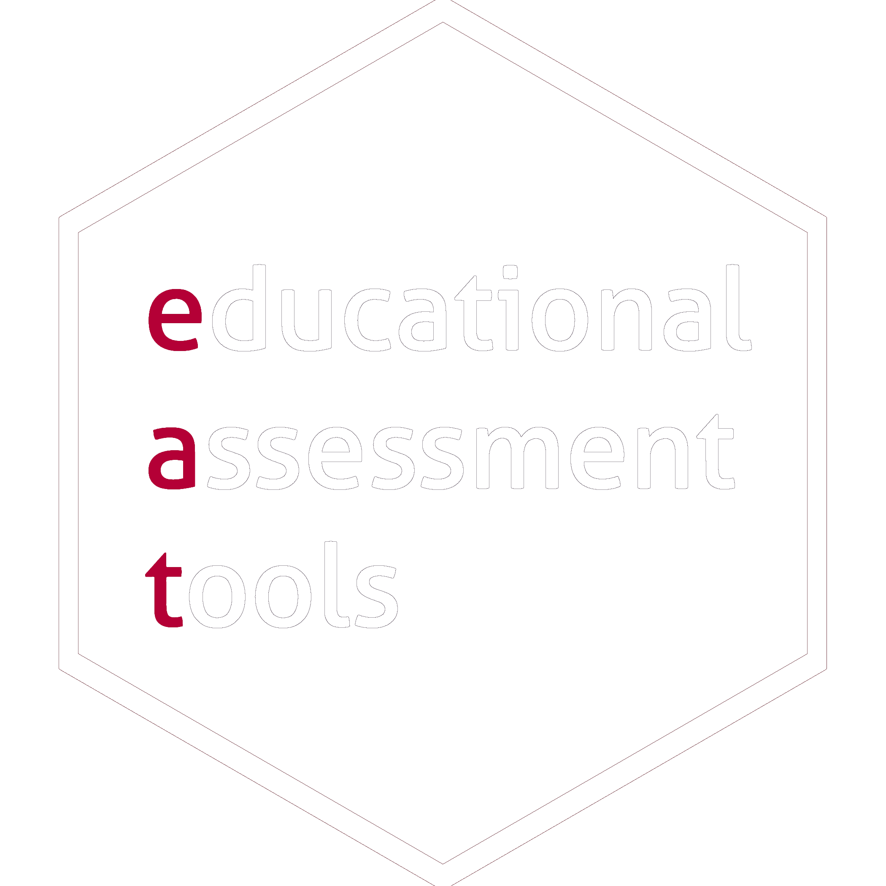

::: {.light-mode}
{fig-alt="educational assessment tools"}
:::

::: {.dark-mode}
{fig-alt="educational assessment tools"}
:::
On this page you can find workshop-slides for the different eat-packages.

## Workshops

::: {eat_workshops}
:::
